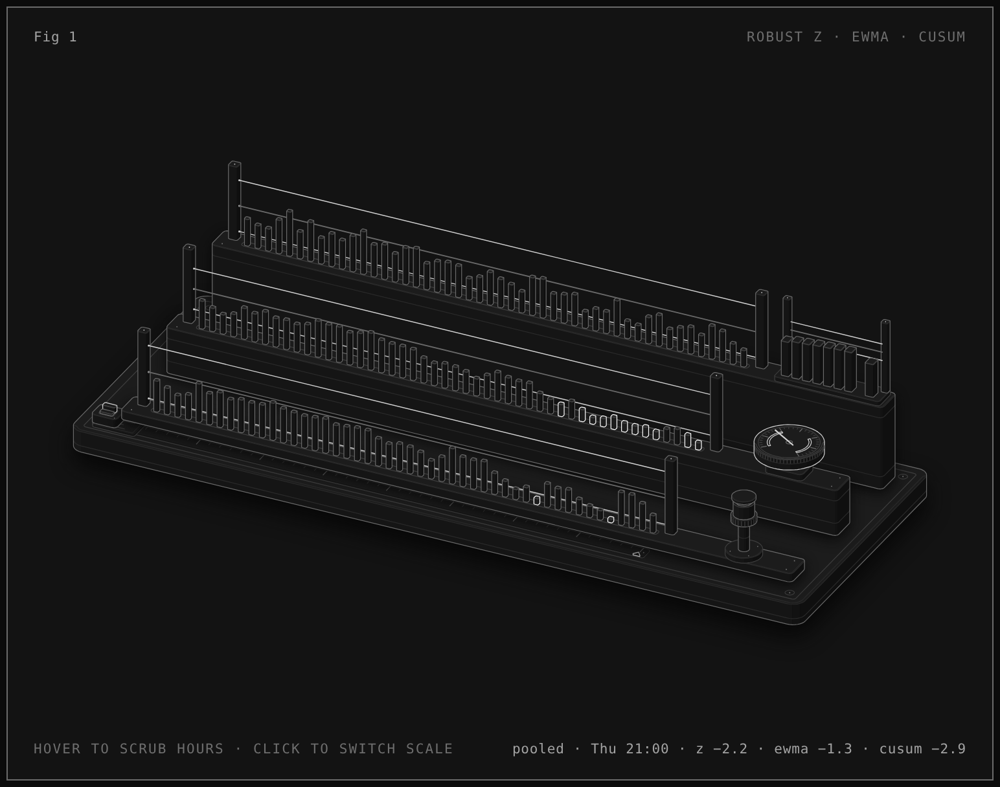

# Hourly volume detectors: robust z, EWMA, CUSUM (synthetic)

Supports `cases/unified-data-observability-and-lineage.md`, open question: which baseline defines a trend, and which volume deviation is meaningful? Built by an AI agent on request; the scenario and parameters are the agent's choices, not decisions.

Open `detectors.html` in a browser for the live figure: hover to move through the hours, click or press S to switch the scale estimate.

## Setup (all simulated, seeded)

- **Volume:** 12,000 messages per hour in weekday shifts (06–22 h), 35 % at night, 55 % at weekends, 6 % hourly noise.
- **Baseline:** median of the same hour of the week on the 7 previous weeks. One history week holds a replay (+60 %, 09–13 h, Mon–Fri).
- **Scale (two variants):** *pooled*, one relative noise figure from all 7 × 168 deviations (1.4826 × median, ×1.217 for the in-sample bias, found by simulation); or *local*, each hour's own 7-point MAD × 1.4826.
- **Detectors:** robust z flagged beyond ±3.5; EWMA of z with λ 0.2 and limit ±3·√(λ/(2−λ)) = ±1.0; two-sided tabular CUSUM of z with k 0.5 and h 5, restarted after each signal.
- **Events:** Tue 06:00 outage (a quarter of the volume), Tue 07:00 backlog processed; Thu 02:00 to Fri 07:00 one producer quiet (−8 %, about −1.3 noise units).

## Results (`node check.mjs`)

| | pooled scale | local 7-point MAD |
|---|---|---|
| Outage and catch-up flagged by robust z | both hours | both hours |
| −8 % shift: robust z | never | once (Thu 10:00) |
| −8 % shift: first EWMA alarm | Thu 08:00 (6 h) | Thu 10:00 (8 h) |
| −8 % shift: CUSUM signals | Thu 10:00, 17:00, Fri 02:00 | Thu 10:00, 16:00, Fri 02:00, 07:00 |
| Alarms away from the events (before Tue 06:00; Wed 08:00 to Thu 01:00) | none | z: 2, CUSUM: 3 |
| Hours to first false alarm, iid normal noise (z / EWMA / CUSUM) | 686 / 263 / 202 | 15 / 21 / 18 |

With 7-point MADs, 6.7 % of clean simulated hours have |z| > 3.5 (normal theory: 0.05 %).

## What this does not show

Nothing here is measured on the real tables. Real hourly volume is not independent normal noise: consecutive hours are correlated (an outage followed by a catch-up), counts are discrete, sparse sources can have a MAD of 0, and holidays break a same-hour-of-week baseline. Each of these changes the false-alarm numbers. False alarms also multiply with the number of monitored series.

## Rebuild

- `node check.mjs` reproduces the numbers above (Node 20+, no dependencies).
- `node build.mjs` rebuilds `detectors.html` (`--light` for the light theme). It needs the figure kit from the anatomy skill (github.com/wheresryan22/anatomy, MIT), found at `~/.claude/skills/anatomy` or `$ANATOMY_DIR`. Viewing the HTML needs nothing.
